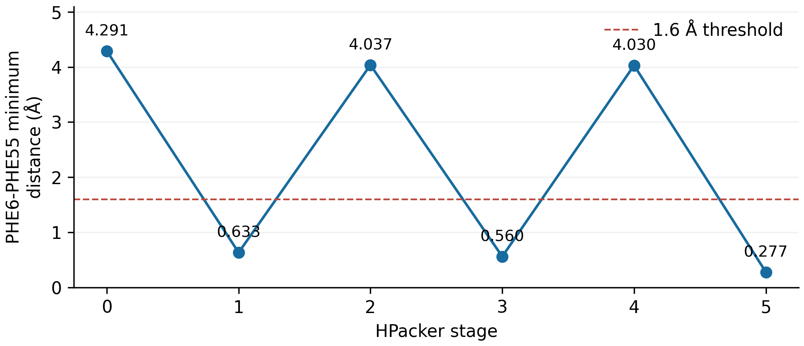
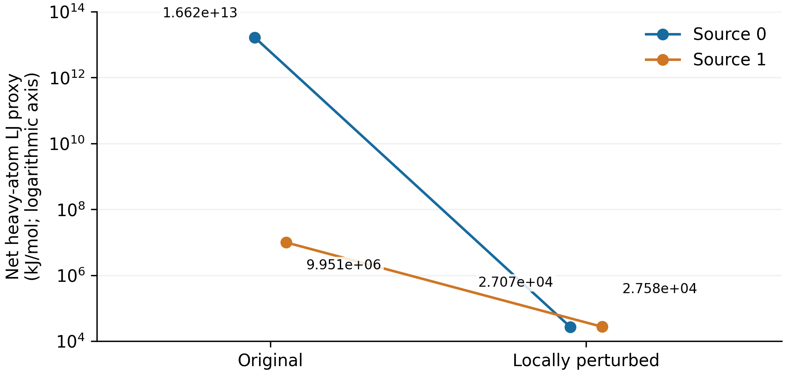

# Supplementary Information

Stage-wise Extreme Atomic Proximity in HPacker Side-chain Reconstruction

Sho Miyazaki | 28 October 2026 | 1.1.0 | DOI: 10.5281/zenodo.23717073

## S1. Input provenance and implementation

### S1.1. Official source and saved input identity

The study uses the WT 2K2A entry of BioEmu samples_delta_G.zip, associated with Zenodo record 15672282 [main text, refs 1 and 5]. The historical archive-entry match JSON identifies delta_G//2K2A/samples.xtc and delta_G//2K2A/topology.pdb by full SHA-256 against the saved inputs, distinguishing similarly named mutant entries. P1 independently rehashed the saved XTC/topology and parsed XTC frame headers: 200 frames, 310 atoms per frame; topology has 310 atoms in 63 residues. The N/CA/C/O backbone selection contains 252 atoms. Header inspection did not decompress XTC coordinates or regenerate backbone inputs.

```text
samples.xtc | 258,900 bytes
SHA-256: 0f42d6d669f5e1c765d0be9299aafc3f127676800d72bfee0c3c4e511ff790b9
topology.pdb | 25,163 bytes
SHA-256: ad00dcbeec51b8941430bba94eadb4226a1e3e495e6644bce9492a193bf10798
```

The archived match receipt reports upstream ZIP size 1,959,113,732 bytes and 3,196 entries. P1 did not download that whole archive or independently recompute its MD5. No whole-archive checksum validation is claimed. The live Zenodo record could not be reread through the available retrieval routes during P1; this is retained as a publication metadata check, not silently treated as fresh source verification.

### S1.2. Conversion and HPacker fingerprints

The BioEmu reconstruction route selects backbone atoms, discards CB, writes one backbone PDB per source frame and invokes H-Packer. The fixed HPacker implementation produced stage 0 (initial prediction) and five refinement stages. Every output used here has the same 494 heavy-atom identifiers in one chain. All 1,200 candidate PDBs match the original first-batch/continuation PDB bytes and their per-source receipt SHA-256, with source IDs 0-199 and stage IDs 0-5. A receipt is provenance evidence; its past PASS label is not an independent scientific certification.

```text
HPacker commit: 6cd5ec33961bb2662b51c0a15d11d6fd9162f2a7
Loaded hpacker.py SHA-256:
38701f5a97873694701313cae09124868f352b563c73ecdf1dc4d486847ce063
BioEmu continuation commit:
42c551133f9825f4ec01812075b0d50e268c2209
```

Per-source environment.json records preserve hashes for initial, refinement and conditioned model hyperparameters and weights. These fingerprints identify the historical implementation; the model weights are not redistributed and P1 did not execute trained inference. See provenance/e1_source_receipts and the archived intervention scripts. The user-supplied Graylab/HPacker URL was inaccessible; the archived implementation and primary publication identify gvisani/hpacker as the relevant upstream repository.

Historical identifier crosswalk: WT0/WT1 mean source frames 0/1 of the same WT ensemble, not different systems. E1 denotes the stage-wise ensemble record; E2 the selected local/NN diagnostics; E3 (Phase C) the four continuations; E4 (Stage A) the restricted LJ proxy. v8.1-v8.4 denote the intervention/diagnostic implementations described in S4. A file-level lookup is in provenance/Internal_Identifier_Crosswalk.csv. Unused parent-study screening labels are omitted from the scientific narrative.

### S1.3. Rights and artifact classes

Saved BioEmu inputs and their coordinate lineage are attributed to the upstream data source. CDLA-Permissive-2.0 accompanies the distributed dataset and coordinate materials, without asserting author ownership of the upstream inputs. Author-written analysis, manuscripts and figure presentation are distinguished from third-party data and software. Eligible original author code is MIT; author-owned prose and figures are CC BY 4.0. Reused Microsoft source retains its MIT notice. Archived intervention outputs and NPZ files retain upstream-data provenance; inclusion does not make every file CC BY or MIT. File-specific classification is in provenance/Rights_Manifest.csv and LICENSES/LICENSE_SCOPE.md.

## S2. Contact definitions and full stage counts

PDB ATOM/HETATM coordinates are parsed as Å into float64 arrays. Hydrogen and deuterium atoms are excluded. Atoms are identified by chain, residue number, insertion code, residue name and atom name, with duplicate identities or nonfinite coordinates rejected. For this fixed single-chain, consecutively numbered 1-63 system, nonadjacent means absolute residue-number separation greater than one. Same-residue/adjacent-residue pairs are omitted; each remaining unordered atom pair is counted once. Distances are Euclidean without periodic wrapping. A contact requires d < 1.6 Å; equality is noncontact.

General stage prevalence counts frames with any eligible contact. The union counts frames with any contact in any stage. Let C_s be the set of exact unordered atom-pair identities present at stage s. Strict recontact requires a pair p with p in C_i, p absent from C_j, and p in C_k for i < j < k. Persistence alone is insufficient. PHE6-PHE55 recontact uses the binary residue-pair sequence b_s and an ordered 1-0-1 triple; the minimum-pair atom names may differ. This distinction is explicit in code/verify_e1_from_pdb.py.

Table S1. Complete fixed-ensemble counts.

| Stage / endpoint | General frames / 200 | PHE6-PHE55 frames / 200 |
| --- | --- | --- |
| 0 | 183 | 39 |
| 1 | 148 | 22 |
| 2 | 140 | 25 |
| 3 | 128 | 23 |
| 4 | 130 | 29 |
| 5 | 134 | 21 |
| Union | 196 | 67 |
| Ordered recontact | 147 (strict same atom) | 43 (residue pair) |
| Full alternation | Not defined | 25 = 10 + 15 |
Stage 0 is the initial HPacker prediction; stages 1-5 are refinement updates, not physical time. Contact requires a distance strictly below 1.6 Å.

The legacy general_same_atom_recontact field in historical frame_summary_200.csv yields 153 because it did not enforce an intervening absence. It is preserved as historical data, not reused as the corrected endpoint. The strict result is 147/200. Synthetic controls verify that persistent contact is not recontact and that contact by a different atom pair does not satisfy same-atom recontact. No threshold sweep or additional scientific endpoint was introduced.

## S3. Representative frame sequence


Figure S1. Source-frame-0 minimum PHE6-PHE55 heavy-atom distance at all six stored HPacker stages. Points and labels use direct three-dimensional PDB distances. The dashed line marks 1.6 Å; contact is strictly below it. Connecting lines indicate stage order, not a continuous dynamical path.

The complete-alternation IDs are: 010101 (10 frames): 0, 10, 34, 53, 73, 83, 88, 167, 180, 191; 101010 (15 frames): 14, 28, 49, 60, 66, 77, 113, 126, 134, 137, 141, 145, 160, 165, 190. The shared denominator is 200. Figure 2 uses the first of these examples without structural regeneration, stage-specific alignment or camera changes.

Closest atom pairs in source 0 (PHE6 atom-PHE55 atom), stages 0-5: CD1-CA, CD1-CZ, CD2-CA, CD1-CE2, CD2-CA, CD1-CE2. Distances rounded to 3 decimals are 4.291, 0.633, 4.037, 0.560, 4.030, 0.277 Å. Backbone atoms are included in the residue-level heavy-atom criterion; the diagrams do not imply a ring-only distance definition. Full unrounded geometry and atom identities are in data/authoritative/Figure_2_Source_0.csv.

## S4. Exploratory interventions and NN diagnostics

### S4.1. Original pulse and χ-intervention mapping

In the masking branch, selected non-backbone side-chain atoms are filtered consistently from neighborhood arrays res_ids, atom_names, elements, coords and charges. The PDB residue itself remains present. For lag, the selected side-chain coordinates temporarily come from stored stage s-2 while neighborhood features are built, after which the original coordinates are restored. The frozen runner rejects lag at s < 2. A later χ substitution edits predicted torsions before Cartesian side-chain reconstruction, not merely the returned angle record. Earlier output-only edits are not promoted to valid structural interventions.

Table S2A-1. Original local-input pulses and subsequent pre-Cartesian χ interventions.

| Source | Pulse stage | Operation | Target residue | Perturbed residue | Measured partner | χ edit stage / residue |
| --- | --- | --- | --- | --- | --- | --- |
| 0 | 2 | third lag | 6 | 55 | 58 | 3 / 17 |
| 1 | 1 | partner mask | 55 | 6 | 6 | 2 / 56 |
The source-0 third_lag branch targets residue 6, perturbs residue 55 and measures partner 58. χ rescue uses baseline χ on the pulse background; the paired archived sufficiency probe uses branch χ on the original background. These operational names do not establish unique causal necessity or sufficiency.

For the source-0 branch, “third” is a stored operation label: the actual perturbed residue is 55, the target is 6 and the measured partner is 58. Source 0 receives a subsequent stage-3 χ edit at residue 17. Source 1 receives a stage-2 χ edit at residue 56. Original rescue and sufficiency branches reverse which stored χ vector is imposed on the branch/original background; these are operational selected probes, not proof of a general causal mediator. Archived code and receipts preserve both branches. Historical mutant cases present in untouched source ZIPs are outside this WT200 analysis.

### S4.2. Downstream blocking

Table S2A-2. Five downstream χ blocks.

| Source | Block stage | Blocked residue(s) | Operation |
| --- | --- | --- | --- |
| 0 | 4 | 53 | Original-branch χ substituted before reconstruction on rescue background |
| 1 | 3 | 3 | Original-branch χ substituted before reconstruction on rescue background |
| 1 | 3 | 55 | Original-branch χ substituted before reconstruction on rescue background |
| 1 | 3 | 55+59+3 | Original-branch χ substituted before reconstruction on rescue background |
| 1 | 3 | 59 | Original-branch χ substituted before reconstruction on rescue background |
The preceding rescue χ edit is retained: source 0 stage 3 residue 17; source 1 stage 2 residue 56. The blocks are path-specific selected perturbations.

The v8.2 implementation retains the earlier rescue χ edit and, one stage later, substitutes selected downstream residues’ χ values from the original pulse branch before reconstruction. The five block receipts and their saved stage PDBs identify the same stage/residue assignments as the code. P1 checked receipt hashes and forced-versus-saved χ values. These selected path-specific blocks do not establish unique necessity, sufficiency or a complete residue-level mechanism.

### S4.3. Saved-array diagnostics

Ten source-stage donor→receiver examples were selected retrospectively: four larger-response and six weaker-response paths. Donor means the side chain whose coordinates were restored for the receiver’s neighborhood diagnostic; it is not an assertion of physiological signaling. The feature metric is the L2 norm of Zernikegram differences. Raw max |Δ| is the maximum absolute difference among the saved eight sin/cos components. χ differences use |((a-b+180) mod 360)-180|, then the maximum over available torsions; no chemical symmetry correction is applied. All figures in Table S2B derive from saved arrays, not new inference.

Table S2B. Ten selected saved-array NN comparisons.

| Key | Source / stage | Donor → receiver | Zernikegram L2 | Raw max |Δ| | Circular χ max |Δ| (°) | Tier |
| --- | --- | --- | --- | --- | --- | --- |
| N006 | 0 / 4 | 53 → 6 | 0.056752 | 0.035291 | 0.239754 | A |
| N025 | 0 / 4 | 53 → 25 | 0.041523 | 0.024820 | 0.053169 | A |
| N050 | 0 / 4 | 53 → 50 | 0.036039 | 0.005751 | 0.082947 | A |
| N055 | 0 / 4 | 53 → 55 | 0.067109 | 0.141019 | 54.088766 | A; R |
| N103 | 1 / 3 | 55 → 3 | 0.211317 | 1.369136 | 148.689018 | A |
| N111 | 1 / 3 | 55 → 11 | 0.100229 | 0.038130 | 0.305740 | A |
| N152 | 1 / 3 | 55 → 52 | 0.024546 | 0.013456 | 0.118828 | A |
| N153 | 1 / 3 | 55 → 53 | 0.137227 | 0.080839 | 0.079979 | A |
| N156 | 1 / 3 | 55 → 56 | 0.198319 | 1.671166 | 178.328796 | A |
| N159 | 1 / 3 | 55 → 59 | 0.231874 | 0.752588 | 52.082260 | A |
A = P1 independent array arithmetic, no trained forward. R = an archived one-point full-batch receipt exists only for N055 (source 0, stage 4, donor 53 → receiver 55); P1 inspected it without rerunning it. Exact array/result paths are in NN_File_Crosswalk.csv. Strong/weak selection is retrospective.

Table S2B keys map to exact original result.json and model_arrays.npz paths in data/authoritative/NN_File_Crosswalk.csv. Their hashes are in SHA256SUMS.txt. In each saved comparison, restored and rescue vectors match. Nonzero raw differences in weaker cases do not imply a binary strong/weak class or a mechanistic threshold. The historical Phase 2B patch arrays support 16 donor-output comparisons at the saved-array level; source raw arrays for some identity/read-only sham controls remain unavailable. P1 does not elevate those controls to full independent replay.

### S4.4. One selected full-batch receipt

data/e2/selected_full_batch/x4_full_batch_replay/original_result.json records source 0, source stage 4, predicted next stage 5, donor 53, receiver 55, batch size 54 and receiver index 46 (zero-based). It links exact blocked/rescue PDB SHA-256 and stored arrays. The archived raw maximum difference is 0.1410191357 and circular χ maximum is 54.08876634°. Reported next-stage χ deviations from stored structures are 0.06389236° (blocked) and 0.59575412° (rescue); this is not bitwise regenerated structure parity.

P1 verified the two PDB identities and inspected the receipt. It did not rerun this trained forward, extend it to ten paths, repeat full-feedback HPacker reconstruction or authenticate every earlier sham. The replay script is supplied as historical source, separate from the read-only P1 verification commands.

## S5. OpenMM methods and continuation

### S5.1. Input identity and system preparation

The four inputs are source 0/1 original stage 5 and their v8.1 locally perturbed stage-5 counterparts. Per-run environment.json records their input SHA-256; P1 matched all four against both the Phase C kit and Stage A v2 input PDBs. The worker START event itself says verified_by_parent rather than repeating the digest: this is parent-environment/runtime provenance, not an independent operating-system file-access trace.

The historical runs used Python 3.13.1, OpenMM 8.2.0, MDTraj 1.11.2 and NumPy 2.5.4. The fixed BioEmu source adds a C-terminal OXT, then hydrogens and solvent. AMBER99SB (amber99sb.xml) and TIP3P (tip3p.xml), 1.0-nm padding, 0.1 M NaCl, PME with 1.0-nm cutoff, hydrogen-bond constraints and rigid water were used. Each input has 494 protein heavy atoms; the returned final protein structure has 495 including OXT. The contact criterion excludes adjacent/same-residue terms, and all four final structures have zero qualifying pairs.

### S5.2. Integrator, restraints and actual platform

After setting coordinates/thermal velocities and applying constraints (1e-7), minimizeEnergy was called with source-default settings. Langevin integration at 300 K used initial friction 200 ps⁻¹ and constraint tolerance 1e-5. Four stabilization blocks of 0.1 ps each used timesteps 1e-6, 1e-5, 1e-4 and 1e-3 ps: 100,000 + 10,000 + 1,000 + 100 steps. NVT then used 100,000 steps at 0.001 ps and friction 10 ps⁻¹ (0.1 ns). NPT used 400,000 steps, friction 1 ps⁻¹ and a 1-bar MonteCarloBarostat (0.4 ns). Total: 611,100 steps and 0.5004 ns. No free-production phase was executed (simtime_ns=0).

The positional potential is k × periodicdistance² with numerical k=1000 in OpenMM’s kJ/mol and nm unit convention, not a silently substituted ½kx² parameterization. It remains active throughout. The code selects atom names N, CA, C and O across the whole system; water oxygens named O can therefore also be restrained. These records must not be called unrestrained or protein-backbone-only free MD. Actual saved platform properties are OpenCL / single precision on Intel Iris Xe Graphics, irrespective of the original CPU-oriented task plan. Stepping probes split calls into chunks ≤1,000 and add synchronization; the stochastic path can differ from an uninstrumented invocation.

### S5.3. Completion records

Table S3. Four archived Phase C continuation records.

| Case | Particles | Waters | Steps | Energy states | Final PE (kJ/mol) | Platform / precision |
| --- | --- | --- | --- | --- | --- | --- |
| s0 original | 11164 | 3395 | 611100 | 226 | -143055.181703 | OpenCL / single |
| s0 perturbed | 11461 | 3494 | 611100 | 226 | -146432.789062 | OpenCL / single |
| s1 original | 11404 | 3475 | 611100 | 226 | -145726.650193 | OpenCL / single |
| s1 perturbed | 11383 | 3468 | 611100 | 226 | -146144.451858 | OpenCL / single |
Each case has exit code 0, 204 matched begin/end calls, one COMPLETE record and no recorded nonfinite energy/position/velocity/force flags. Integration duration is 0.5004 ns, including four 0.1-ps stabilization stages. Solvent counts differ; final PE values cannot be ranked as stability.

P1 checked continuity of requested/completed steps, the four COMPLETE/exit records, finite saved energy/position/velocity/force checkpoints, final-PDB hashes and final contact geometry. This verifies the recorded continuation outcomes; it does not rerun MD, prove finite values at every unrecorded integration step, establish comparative success rates or permit ranking differently solvated systems by final potential energy. Main-text Table 4 intentionally contains only initial-input and final-MD counts.

### S5.4. Separate WT0 minimization-only structures

The independently archived M2 run outputs/m2_wt0_20261023_140630 contains baseline_minimized_heavy.pdb and rescue_minimized_heavy.pdb. Direct geometry gives zero qualifying pairs in each. These are a separate WT source-0 minimization-only execution, not Phase C intermediate coordinates. No WT1 minimization-only PDB or verified close-pair count is available in the supplied evidence. AFTER_MIN energy records cannot supply a coordinate-based contact count. P1 neither generated missing checkpoints nor inferred WT1 values.

## S6. Protein heavy-atom LJ proxy

### S6.1. Pair set and parameters

Stage A evaluates the common 494 original protein heavy atoms, with 116,140 eligible nonadjacent interresidue pairs per structure (464,560 pair rows total). Same-residue and adjacent-residue pairs and zero-epsilon exclusions are omitted. AMBER99SB nonbonded parameters come from the historical protein-only NoCutoff surrogate; Lorentz-Berthelot mixing uses arithmetic σ and geometric ε. Original NonbondedForce exception parameters are honored where applicable. Temporary OXT and added hydrogens enable force-field typing only and are excluded from the analyzed 494-heavy-atom pair set.

Each pair contributes 4ε[(σ/r)¹²-(σ/r)⁶], with r and σ in nm, ε and energy in kJ/mol. No solvent, ion, electrostatic, bonded, hydrogen-containing-pair or whole-system term is included. The historical Phase1A audit independently checked parameter typing (952 particles and 5,144 exceptions in the typing systems); P1 retained that evidence but did not repeat system construction or hydrogen optimization. P1 recalculated pairwise arithmetic from the archived σ/ε values and measured every analyzed pair distance from the original PDBs.


Figure S2. Positive archived net protein heavy-atom LJ proxy values for the two selected original/locally perturbed pairs, on a logarithmic y axis. Connecting lines identify paired selected structures, not a thermodynamic path. Values use archived Stage A summaries; Table S4 separates coordinate precision and CSV-summation variants.

### S6.2. Precision and accumulation pathways

Table S4A. LJ coordinate-pathway and accumulation comparisons.

| Source / structure | Archived summary (kJ/mol) | Archived CSV sum (kJ/mol) | PDB-double recomputation (kJ/mol) |
| --- | --- | --- | --- |
| 0 / Original | 1.66168e+13 | 1.66168e+13 | 1.66141e+13 |
| 0 / Locally perturbed | 27071.4 | 27071.4 | 27071.3 |
| 1 / Original | 9.95131e+06 | 9.95131e+06 | 9.9511e+06 |
| 1 / Locally perturbed | 27582.9 | 27582.9 | 27584.1 |
Values are rounded to six significant figures for display. Complete values remain in Table_S4A.csv. Archived summary and CSV sum are not identical: for source-0 original the difference is about 10.25 kJ/mol (relative 6.17×10⁻¹³); rounding hides that distinction. PDB-double is a separate coordinate pathway.

The archived coordinate route rounds PDB-derived nm coordinates through float32 before distance evaluation. P1 reproduced saved pair distances from this route to less than 1e-12 Å. Direct float64 calculations from the original 0.001-Å PDB coordinates are a different numerical route; the original source-0 minimum distance is 0.2772742325 Å, compared with 0.2772704097 Å in saved LJ rows. The r⁻¹² term amplifies that small difference. Finite decimal CSV entries and different accumulation order also produce tiny relative differences between pair sums and summary totals. The archived summary, saved CSV sum and PDB-double result remain separate; none is relabeled as an identical value.

Table S4B. Same-pair distance and contribution tracking.

| Source | Baseline-dominant pair | Original distance (Å) | Perturbed same-pair distance (Å) | Share of proxy reduction (%) |
| --- | --- | --- | --- | --- |
| 0 | 6:PHE:CD1 - 55:PHE:CE2 | 0.277270 | 5.514235 | 99.9999991 |
| 1 | 6:PHE:CG - 55:PHE:CE2 | 0.915895 | 6.335595 | 99.1752655 |
Shares use the archived pair contribution and archived summary reduction. The measured pair is fixed by its baseline dominance, not by the nearest pair in the perturbed structure.

The dominant pair’s contribution to the net proxy reduction is computed from its archived pair-energy decrease divided by the archived total decrease. The same atom identities are tracked in the locally perturbed structure. These results describe a restricted arithmetic consequence of extreme proximity. They are not a decomposition of the solvated Phase C potential, a stability ranking or evidence about folding free energy.

## S7. Reproducibility and evidence boundaries

Table S5. Claim-evidence-file-verification map.

| Claim | Evidence | Package file / directory | Verification tier |
| --- | --- | --- | --- |
| E1 stage counts / recontact | 1,200 original stage PDBs + receipts | data/pdb; provenance/PDB_SHA256_Manifest.csv | P1 independent geometry and SHA |
| Source-0 local geometry | Original and perturbed stage-5 PDBs | data/e4/inputs; verification/current/e1_stages.csv | P1 independent geometry |
| Ten NN-response comparisons | Saved NPZ vectors + result JSON | data/e2/v83; data/e2/v84; NN_File_Crosswalk.csv | P1 saved-array arithmetic |
| One selected full-batch diagnostic | 54-residue batch receipt, arrays, two PDBs | data/e2/selected_full_batch | Archived forward receipt inspected; no P1 forward |
| Selected continuation | Four run environments, logs, summaries and final PDBs | data/e3/phase_c/outputs_phase_c | P1 log, SHA and final geometry |
| Separate WT0 minimized geometry | Two M2 minimized PDBs | data/e3/separate_m2 | P1 geometry; separate run |
| Restricted LJ proxy | 4×116,140 pair rows + selected input PDBs | data/e4/results; data/e4/inputs | P1 pairwise arithmetic / PDB doubles |
| Force-field typing | Archived code and Phase1A parameter audit | code/archived_execution; provenance/phase1a_historical | Historical independent typing; no new typing |
Full file hashes are in SHA256SUMS.txt. Read-only verifiers are code/verify_e1_from_pdb.py and code/verify_supporting_records.py. No universal NN, HPacker or MD replay is claimed.

### S7.1. Read-only verification commands

```text
python code/verify_e1_from_pdb.py --root . --out verification/recheck
python code/verify_supporting_records.py --root . --out verification/recheck
python code/verify_package_hashes.py .
```

Run from the unpacked Zenodo candidate using Python ≥3.10 and NumPy. The E1 verifier checks the full source/stage grid, SHA manifest, receipt SHA where present, finite/unique atom identities, all original stage-table fields, strict sequence definitions and frozen expected JSON. The supporting verifier checks saved arrays/receipts, Phase C logs and coordinates, separate WT0 M2 structures, and the complete pairwise LJ arithmetic. No model installation, weights, OpenMM invocation or MD is required. GitHub omits full PDB and large E2/E4 data: use the matching Zenodo candidate for complete rechecks, as explained in REPRODUCIBILITY.md.

### S7.2. Chronology and unresolved boundaries

The core archive was summarized on 21 October 2026; selected continuation and Stage A ended on 23 October. Published v1.0.0 is a separate historical release. The 27 October P1 production revised exposition, strict-counter reporting, traceability and packaging without new scientific execution. Version 1.1.0 bears the reserved version DOI 10.5281/zenodo.23717073; DOI registration and record availability occur upon Zenodo publication. Historical P1 self-QC and subsequent P2 checks are distinguished from scientific experiments.

The named corrected outer ZIP and its README were not attached. All 14 specified constituent inputs were present separately and matched ATTACHMENT_MANIFEST.csv exactly by byte size and SHA-256, including renamed Phase C and verification files. Nested original ZIPs were indexed recursively and duplicate content identified by SHA. Windows backslash member names were normalized only for extracted working/package copies; original source ZIP bytes were preserved. Reference N1 and NT-BE/X2-ω PDFs informed editing only and supplied no X4 scientific evidence, conditions or licenses.

The source archive and associated GitHub materials document the provenance and reproducibility limits. Original simulation dates and earlier validation records have been preserved. Author has reviewed rights, funding, interests and acknowledgments. The live source retrieval limitation and unavailable full-archive MD5 are disclosed, not marked PASS. No new BioEmu generation, HPacker inference, NN intervention, minimization, MD, public upload, push or metadata update was performed.
